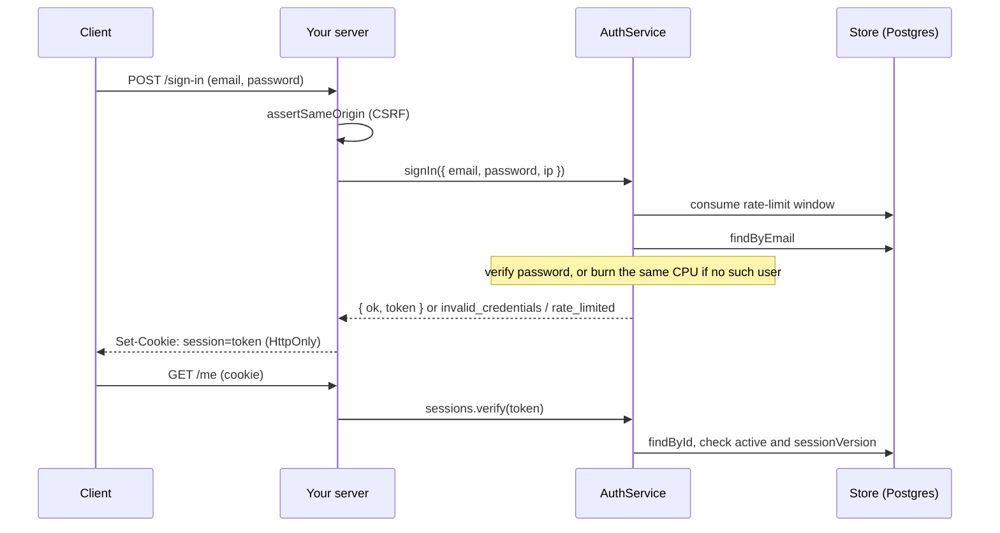

# authcore-ts

[](https://github.com/raphgm/authcore-ts/actions/workflows/ci.yml)

Framework-agnostic TypeScript building blocks for application auth: bcrypt password hashing, signed sessions you can revoke, typed role-based access control, rate limiting, CSRF origin checks and single-use password-reset tokens.

It was extracted from the authentication code of [AssetOps](https://github.com/raphgm/AssetOps) (a Next.js and Prisma app), with the framework and database coupling removed and a handful of real weaknesses fixed on the way. See [What changed from the original](#what-changed-from-the-original).

## Install

Not on npm yet. Install from GitHub (the package builds itself on install):

```bash
npm install github:raphgm/authcore-ts
```

Requires Node 20 or newer. ESM and CommonJS are both supported.

## Quick start

This is [`examples/quickstart.ts`](examples/quickstart.ts), which is type-checked in CI and runs as shown.

```ts
import {
  AuthService, MemoryRateLimiter, MemoryResetTokenStore, MemoryUserStore,
  PasswordHasher, ResetTokenService, SessionService, defineRbac, type AuthUser,
} from "authcore-ts";

// 1. Describe who can do what. Names are checked by the compiler.
const rbac = defineRbac({
  ADMIN: ["asset:read", "asset:write", "user:manage"],
  TECHNICIAN: ["asset:read"],
} as const);

// 2. Extend AuthUser with your own fields.
interface User extends AuthUser {
  role: "ADMIN" | "TECHNICIAN";
}

// 3. Pick storage. Swap MemoryUserStore for PostgresUserStore in production.
const hasher = new PasswordHasher(); // bcrypt cost 12
const users = new MemoryUserStore<User>();
users.add({
  id: "u1", email: "ada@example.com",
  passwordHash: await hasher.hash("correct horse battery"),
  role: "TECHNICIAN", active: true, sessionVersion: 0,
});

// 4. Wire the services.
const sessions = new SessionService<User>({
  secret: process.env["SESSION_SECRET"] ?? "development-only-secret-0123456789abcdef",
  findUserById: (id) => users.findById(id),
});
const auth = new AuthService<User>({
  users, hasher, sessions,
  resetTokens: new ResetTokenService(new MemoryResetTokenStore()),
  rateLimiter: new MemoryRateLimiter(),
});

// 5. Sign in, then resolve the session on later requests.
const result = await auth.signIn({ email: "ada@example.com", password: "correct horse battery", ip: "203.0.113.7" });
if (!result.ok) throw new Error(result.reason);
const user = await sessions.verify(result.token);
rbac.can(user!.role, "asset:write"); // false

// 6. Resetting the password signs the user out everywhere.
const reset = await auth.requestPasswordReset("ada@example.com");
await auth.resetPassword(reset!.token, "a brand new passphrase");
await sessions.verify(result.token); // null
```

## What is in the box

| Piece | What it does |
| --- | --- |
| `PasswordHasher` | bcrypt over a SHA-256 pre-hash (no 72-byte truncation), reads legacy plain-bcrypt hashes, flags them for upgrade, and burns equal CPU for unknown users |
| `SessionService` | HS256 signed tokens, algorithm pinned, secret length enforced, revocable through a per-user `sessionVersion` |
| `AuthService` | sign-in (rate limited, constant work), password reset (single-use, revokes sessions), audit hook with no personal data |
| `defineRbac` | role to permission matrix with compile-time checked names |
| `ResetTokenService` | random 256-bit tokens, only the SHA-256 is stored, one active link per user |
| `isSameOrigin` / `assertSameOrigin` | origin check for cookie-session endpoints |
| `serializeSessionCookie` and friends | HttpOnly, SameSite=Lax, Secure by default |
| `MemoryRateLimiter`, `PostgresRateLimiter` | fixed-window limits; the Postgres one is shared across instances |
| `MemoryUserStore`, `PostgresUserStore` and token stores | storage behind small interfaces (`UserStore`, `ResetTokenStore`, `RateLimiter`) |

The Postgres stores take any object with a `query(text, values)` method (such as a `pg` Pool), so the library has no database dependency. The schema is exported as `POSTGRES_SCHEMA_SQL`.

## How a sign-in flows



## What changed from the original

Each row is covered by a test, and the "evidence" column names the runnable demo or test that shows it.

| Original behaviour (AssetOps) | In authcore-ts | Evidence |
| --- | --- | --- |
| Sign-in skipped the password check when the email did not exist, so unknown emails answered far faster | One verification is always performed | `npm run demo:timing`, `auth-service.test.ts` |
| A password reset left every existing session valid for up to 7 days | Resetting the password bumps `sessionVersion`, revoking all sessions | `npm run demo:sessions`, `auth-service.test.ts`, smoke test |
| bcrypt silently ignored everything after 72 bytes | SHA-256 pre-hash; old hashes still verify and upgrade on next sign-in | `npm run demo:truncation`, `password.test.ts` |
| In-memory rate limiter, one counter per process | `RateLimiter` interface plus an atomic `PostgresRateLimiter` | `contract.ts` (30 concurrent requests, exactly `max` allowed) |
| Failed sign-ins logged the raw email address | Audit events carry no email | `auth-service.test.ts` |
| JWT verified without pinning the algorithm; any error counted as signed out | Only HS256 accepted; a database outage is an error, not a silent sign-out | `session.test.ts` |
| Single-use reset tokens relied on separate read and write steps | One conditional `UPDATE`; atomic under concurrency | `npm run demo:race`, `contract.ts` |
| Coupled to Next.js cookies and Prisma | Plain interfaces; any framework, any store | the example server |

## Run the example server

```bash
docker compose up --build        # app on :3000, with Postgres
./scripts/smoke.sh               # 23 end-to-end checks over real HTTP
```

The server in [`examples/server/server.ts`](examples/server/server.ts) shows sign-in, sign-out, a protected route, role checks, password reset and a health check. It prints reset links to the log instead of sending email, which is for trying it out only.

## Limits worth knowing

- Sessions are stateless. Signing out clears the browser cookie but does not invalidate the token; call `revokeSessions` to sign a user out everywhere.
- The in-memory rate limiter is correct only for one process. Use `PostgresRateLimiter` (or your own implementation) for several instances.
- You send the reset email. `requestPasswordReset` returns the token; respond identically whether or not the user exists, and send the email asynchronously so response time does not give the answer away.
- Rate limiting and CSRF are only as good as the client address and origin you give them. Trust `X-Forwarded-For` only behind a proxy you control.
- Tested against Postgres 16 (16.13 locally, and the `postgres:16` image in CI). Other databases need their own store implementations; the contract tests in `test/contract.ts` define what they must satisfy.

## Development

```bash
npm ci
npm run typecheck && npm run lint
npm test                                                        # in-memory stores
DATABASE_URL=postgres://postgres@localhost:5432/authcore npm test   # plus real Postgres
npm run test:coverage
npm run build && npm run check:package                          # publint and are-the-types-wrong
```

Scripts in `scripts/` reproduce the measurements above: `demo:timing`, `demo:truncation`, `demo:sessions`, and `demo-race.ts` (needs `DATABASE_URL`).

## License

MIT
